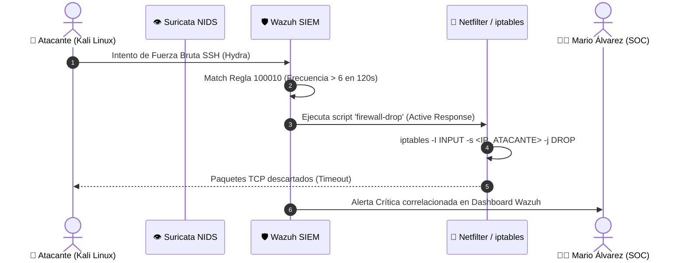

# 🛡️ SOC Detection Engineering & Defense-in-Depth Architecture

[](https://wazuh.com)
[](https://suricata.io)
[](https://attack.mitre.org)
[](https://docker.com)
[](https://tailscale.com)

**Repositorio Técnico Oficial de Reglas de Detección, Políticas de Filtrado Perimetral e Ingeniería de Detección SOC.**  
**Autor:** [Mario de Jesús Álvarez Ramos](https://www.linkedin.com/in/mario-de-jesús-álvarez-ramos-32b828289)  
**Servidor en Producción:** `malvarezserv` (Ubuntu 26.04 LTS)

---

## 📌 Visión General

Este repositorio almacena los artefactos de código, reglas personalizadas en formato XML para **Wazuh SIEM/XDR**, firmas NIDS para **Suricata**, scripts de **Respuesta Activa (Active Response)** y matrices de segmentación de firewall perimetral (**OPNsense / Linux Netfilter**).

Todo el contenido fue desarrollado, probado bajo fuego con herramientas ofensivas (Kali Linux, Hydra, Nmap, Nikto, ApacheBench) y validado en un entorno de servidores real con arquitectura contenerizada en microservicios.

---

## 🗂️ Estructura del Repositorio

```text
├── wazuh/
│   ├── rules/
│   │   └── local_rules.xml         # Reglas personalizadas con mapeo MITRE ATT&CK
│   └── config/
│       └── ossec.conf              # Configuración de Active Response, FIM y Syscheck
├── suricata/
│   └── rules/
│       └── local.rules             # Firmas NIDS para escaneos stealth y ataques web
├── firewall-opnsense/
│   └── network_segmentation_rules.md  # Políticas de filtrado, ACLs y segmentación VLAN
└── README.md                       # Documentación técnica ejecutiva
```

---

## 🎯 Matriz de Reglas de Detección & Mapeo MITRE ATT&CK

| Rule ID | Componente | Técnica MITRE ATT&CK | Táctica | Nivel de Severidad | Acción / Mitigación Automática |
| :---: | :---: | :--- | :--- | :---: | :--- |
| **`100010`** | Wazuh | **T1110.001** (Password Guessing) | Credential Access | **10** (Alta) | Correlación de ráfagas SSH (Hydra). |
| **`100011`** | Wazuh | **T1078** (Valid Accounts) | Defense Evasion | **13** (Crítica) | Detección de login exitoso post-brute force. |
| **`100020`** | Wazuh | **T1190** (Exploit Public-Facing App) | Initial Access | **12** (Crítica) | Bloqueo por Active Response (`firewall-drop`). |
| **`100021`** | Wazuh | **T1083** (File and Directory Discovery) | Discovery | **11** (Alta) | Detección de Directory Traversal (`/etc/passwd`). |
| **`100022`** | Wazuh | **T1190** (Cross-Site Scripting) | Initial Access | **10** (Alta) | Alerta temprana en logs de Reverse Proxy Nginx. |
| **`100023`** | Wazuh | **T1595.002** (Vulnerability Scanning) | Reconnaissance | **9** (Media) | Reconocimiento de User-Agents maliciosos. |
| **`100030`** | Wazuh FIM | **T1565.001** (Internal Data Manipulation)| Impact | **12** (Crítica) | Monitoreo de integridad con hashes SHA256. |
| **`100040`** | Wazuh/Suricata | **T1046** (Network Service Discovery) | Discovery | **12** (Crítica) | Correlación de eventos `eve.json` Nmap. |
| **`1000001`**| Suricata | **T1046** (SYN Stealth Port Scan) | Discovery | Alert | Firma NIDS por ráfaga SYN anómala. |
| **`1000003`**| Suricata | **T1595.002** (Nikto Web Scanner) | Reconnaissance | Alert | Inspección profunda de cabeceras HTTP. |

---

## ⚡ Flujo de Respuesta Activa (Mitigación en Kernel)



---

## 🚀 Despliegue & Pruebas en Laboratorio

### 1. Aplicar las Reglas Personalizadas en Wazuh
Copia el archivo `wazuh/rules/local_rules.xml` al contenedor o directorio del Wazuh Manager:
```bash
sudo cp wazuh/rules/local_rules.xml /var/ossec/etc/rules/local_rules.xml
sudo /var/ossec/bin/wazuh-analysisd -t  # Verificar sintaxis XML
sudo systemctl restart wazuh-manager
```

### 2. Cargar Firmas NIDS en Suricata
```bash
sudo cp suricata/rules/local.rules /var/lib/suricata/rules/local.rules
sudo suricata-test -c /etc/suricata/suricata.yaml -s /var/lib/suricata/rules/local.rules
sudo systemctl restart suricata
```

---

## 👤 Acerca del Autor

- **Ingeniero:** Mario de Jesús Álvarez Ramos
- **Especialidad:** Administración de Redes, Infraestructura TI & Operaciones SOC (Wazuh SIEM / Suricata NIDS)
- **GitHub:** [github.com/kigmario01](https://github.com/kigmario01)
- **LinkedIn:** [linkedin.com/in/mario-de-jesús-álvarez-ramos-32b828289](https://www.linkedin.com/in/mario-de-jesús-álvarez-ramos-32b828289)
- **Portal & Centro de Comando:** [https://malvarezserv.tail19bc30.ts.net/portal/](https://malvarezserv.tail19bc30.ts.net/portal/)
