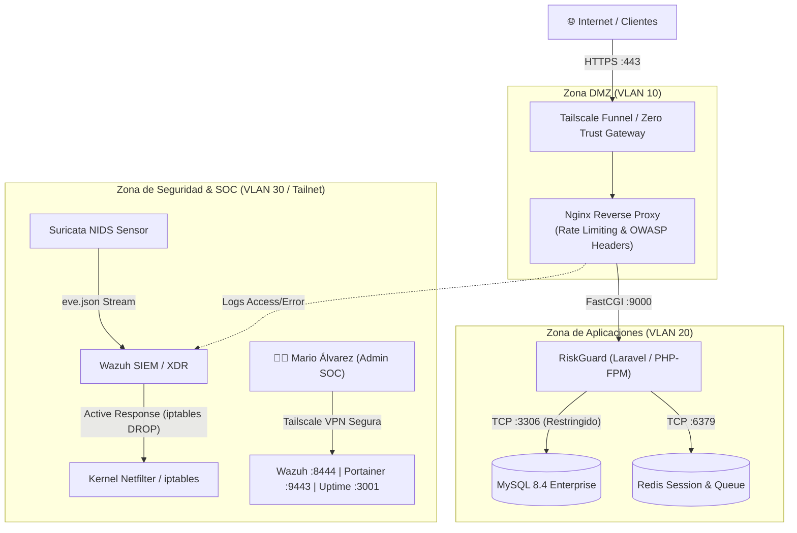

# 🛡️ Políticas de Firewall, Segmentación de Red & Control de Acceso (OPNsense / Netfilter)

**Autor:** Mario de Jesús Álvarez Ramos  
**Rol:** Administrador de Redes & Sistemas | Analista de Ciberseguridad Defensiva (SOC)  
**Entorno:** Red Empresarial & Servidor de Microservicios (`malvarezserv`)

---

## 1. Matriz de Segmentación de Red (VLANs & Zonas de Seguridad)

Para garantizar el principio de **Mínimo Privilegio (Least Privilege)** y **Defensa en Profundidad**, la infraestructura se segmenta en tres zonas de seguridad aisladas:

| Zona | Subred / VLAN | Propósito | Nivel de Confianza | Políticas de Aislamiento |
| :--- | :--- | :--- | :--- | :--- |
| **DMZ / Reverse Proxy** | VLAN 10 (`172.20.0.0/24`) | Nginx Reverse Proxy, Funnel Endpoints | Bajo / Expuesto | Tráfico saliente a LAN prohibido. Solo conexiones iniciadas hacia puertos específicos de la red de servicios. |
| **App & Backend Tier** | VLAN 20 (`172.21.0.0/24`) | RiskGuard PHP-FPM, MySQL 8.4, Redis, Uptime Kuma | Medio / Interno | Aislamiento inter-contenedor mediante Docker custom bridges. MySQL (3306) solo acepta conexiones de PHP-FPM. |
| **SOC & Management** | VLAN 30 / Tailnet (`100.87.88.0/24`) | Wazuh SIEM (8444), Indexer (9200), Portainer (9443), SSH (22) | Crítico / Zero Trust | **Acceso WAN 100% denegado por defecto**. Solo accesible mediante autenticación mutua WireGuard/Tailscale. |

---

## 2. Reglas de Filtrado de Paquetes (OPNsense / iptables Rule-base)

### 2.1 Política por Defecto (Default Deny)
```text
Action: DROP
Direction: IN / OUT
Interface: WAN
Source: ANY
Destination: ANY
Description: Bloqueo explícito de todo tráfico no autorizado por reglas específicas (Zero Trust).
```

### 2.2 Reglas Perimetrales de Entrada (WAN Inbound Rules)

```text
# REGLA 01: Protección Anti-Spoofing & RFC 1918 en interfaz pública
PASS Block Private Networks (RFC 1918 / Bogons) on WAN interface.

# REGLA 02: Acceso Seguro a Servicios Públicos (Reverse Proxy DMZ)
PASS IN on WAN proto TCP from ANY to DMZ_VIP port { 443, 80 }
  flags S/SA keep state (max 1000, source-track rule, max-src-nodes 50, max-src-conn 20, max-src-conn-rate 15/1)
  Description: Permite tráfico HTTPS balanceado hacia Nginx con Rate Limiting preventivo.

# REGLA 03: Bloqueo Estricto de Consolas de Gestión desde Internet
DROP IN on WAN proto TCP from ANY to ANY port { 22, 3306, 6379, 8444, 9200, 9443, 3001 }
  log (all)
  Description: Mitigación de vector de ataque por enumeración de puertos o brute force contra servicios críticos.
```

### 2.3 Reglas Inter-Zona (Inter-VLAN Routing & ACLs)

```text
# REGLA 04: Comunicación DMZ hacia Aplicaciones
PASS IN on VLAN10 proto TCP from IP_NGINX to IP_LARAVEL port 9000
  flags S/SA keep state
  Description: Enrutamiento FastCGI exclusivo entre Nginx y PHP-FPM.

# REGLA 05: Protección de la Base de Datos
PASS IN on VLAN20 proto TCP from IP_LARAVEL to IP_MYSQL port 3306
DROP IN on VLAN20 proto TCP from ANY to IP_MYSQL port 3306
  log (all)
  Description: Únicamente el backend autenticado de la aplicación puede consultar el motor SQL.
```

---

## 3. Integración de Respuesta Activa en el Kernel (Linux Netfilter / iptables)

Cuando Wazuh SIEM detecta un ataque de fuerza bruta SSH (Regla `5712`) o un escaneo agresivo Nmap detectado por Suricata (Regla `100040`), el script de Respuesta Activa ejecuta dinámicamente en el firewall:

```bash
# Regla generada dinámicamente en runtime por Wazuh Active Response:
sudo iptables -I INPUT -s <IP_ATACANTE> -j DROP -m comment --comment "Wazuh-Active-Response-AutoBlock"

# Verificación de mitigación forense:
sudo iptables -L INPUT -v -n --line-numbers | grep "Wazuh"
```

---

## 4. Topología Lógica de Red


